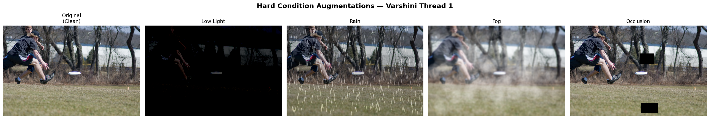
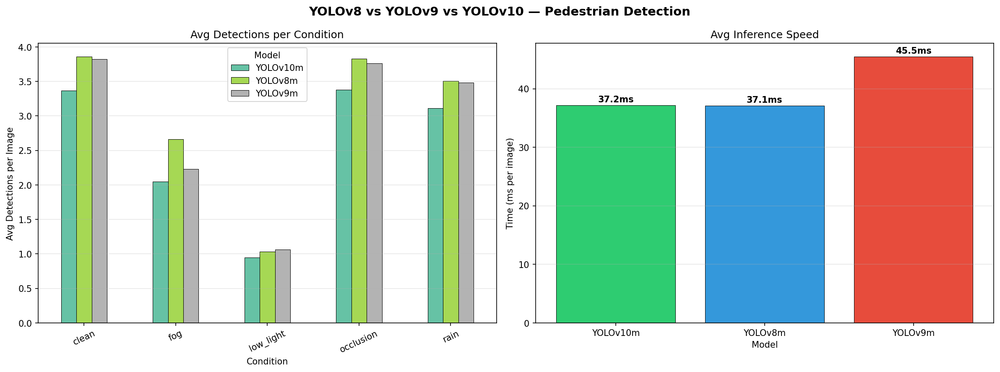
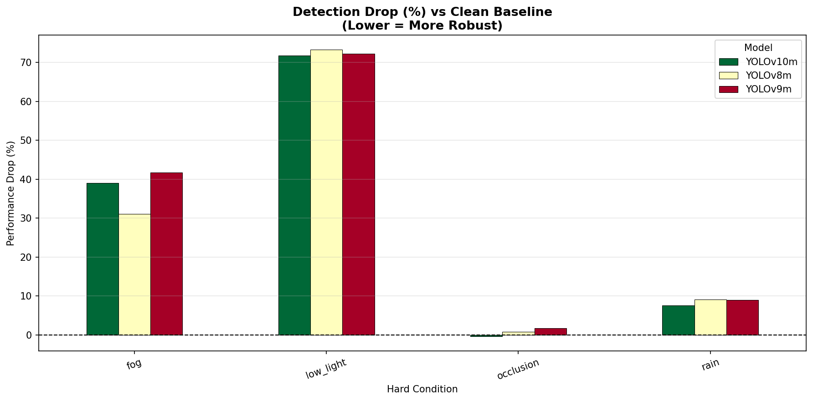
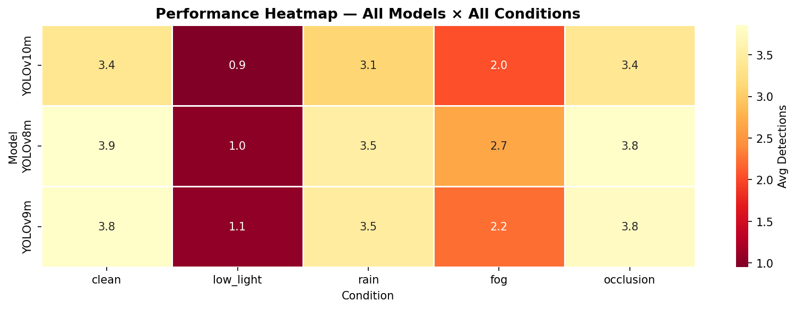
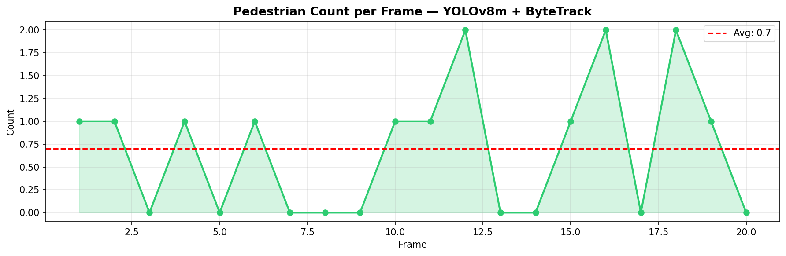

# Pedestrian & Cyclist Detection Under Real-World Conditions
## Comparing YOLOv8 vs YOLOv9 vs YOLOv10 with Hard Condition Benchmarking

> **Motivated by Prof. Banafsheh Rekabdar's active research at Portland State University: "Automated Detection, Tracking, and Safety Analysis of Pedestrians and Cyclists Using YOLOv9" (PSU TREC Project #1626, in progress)**

---

## Author
**Krishna Varshini Ilindra**  
MS in Computer Science — University of Bridgeport (GPA: 3.636)  
Teaching Assistant — Computer Vision Course GitHub: github.com/krishna-Varshini-Ilindra 

---

## Project Goal

This project compares three pretrained YOLO detectors (YOLOv8m, YOLOv9m, YOLOv10m) for pedestrian detection on clean images and under four simulated adverse conditions: low light, rain, fog, and occlusion. It also includes a small fine-tuning experiment and a ByteTrack tracking pipeline demo.

---

## Research Questions

1. How many pedestrians does each YOLO variant detect on clean images?
2. How much does each model's detection output change under simulated adverse conditions?
3. Can a short fine-tuning run on pedestrian-only labels be set up end to end?
4. Can ByteTrack be integrated for pedestrian ID assignment?

---

## Tech Stack

| Tool | Purpose |
|---|---|
| Python 3.12 | Core language |
| PyTorch 2.11 | Deep learning framework |
| Ultralytics 8.4.67 | YOLOv8/v9/v10 models |
| Albumentations | Hard condition augmentations |
| OpenCV | Image processing |
| ByteTrack | Multi-object pedestrian tracking |
| Pandas / Matplotlib / Seaborn | Analysis & visualization |
| Google Colab T4 GPU | Training & inference |

---

## Dataset

- COCO val2017, filtered to images containing at least one person (2,693 of 5,000)
- 200 images used for the clean baseline
- 100 of those 200 images used for each adverse condition
- Person = YOLO class 0 (COCO category_id 1)

Note: For full research, replace with the EuroCity Persons dataset (eurocity-dataset.tudelft.nl) which is the dataset used in Prof. Rekabdar's project.

---

## Experimental Setup

### Models Compared
| Model | Parameters | Weight Size | Key Innovation |
|---|---|---|---|
| YOLOv8m | 25,902,640 | 49.7 MB | Anchor-free head, C2f blocks |
| YOLOv9m | 20,216,160 | 39.1 MB | Programmable Gradient Info (PGI) |
| YOLOv10m | 16,576,768 | 32.1 MB | NMS-free detection head |

### Conditions Tested
| Condition | Simulation Method | Real-World Scenario |
|---|---|---|
| Clean | Original images | Daytime street camera |
| Low Light | Brightness -40-60% + noise | Night/dusk footage |
| Rain | Heavy rain streak overlay | Rainy day camera |
| Fog | White haze overlay (coef 0.4-0.7)| Foggy morning road |
| Occlusion | Random black patches (CoarseDropout) | Partially blocked view |

Inference settings: conf = 0.25, IoU = 0.45, classes = [person].

Note on the metric: The robustness comparison counts predicted person boxes per image. It does not compare predictions to ground-truth labels, so a change in detection count is a proxy for missed detections, not a measure of accuracy. See Limitations.
---

## Results

### Baseline Detection (Clean,200 Images)
| Model | Total Detections | Avg per Image | Median Time per Image
|---|---|---|---|
| YOLOv8m | 772 | 3.86 | 32.0ms |
| YOLOv9m | 765 | 3.82 | 43.8ms |
| YOLOv10m | 673 | 3.36 | 36.3ms |

*End-to-end time per model() call on a Colab T4 (includes pre- and post-processing). Medians reported because the first image of each run includes GPU warm-up (~3s).

### Hard Condition Results (100 images each)
| Condition | YOLOv8m | YOLOv9m | YOLOv10m |
|---|---|---|---|
| Clean (same 100 images) | 391 | 385 | 340 |
| Low Light | 103 | 106 | 95 |
| Rain | 351 | 348 | 311 |
| Fog | 266 | 223 | 205 |
| Occlusion | 383 | 376 | 338 |

### Performance Drop vs Clean Baseline (same 100 images)
| Condition | YOLOv8m | YOLOv9m | YOLOv10m |
|---|---|---|---|
| Low Light | ~73.7% drop | ~72.5% drop | ~72.1% drop |
| Fog | ~32.0% drop | ~42.1% drop | ~39.7% drop |
| Rain | ~10.2% drop | ~9.6% drop | ~8.5% drop |
| Occlusion | ~2.0% drop | ~2.3% drop | ~0.6% drop |

### Fine-Tuned YOLOv8m Results (10 epochs, 160 train / 40 val images)
| Metric | Value |
|---|---|
| mAP@50 | 0.375 |
| mAP@50-95 | 0.211 |
| Precision | 0.482 |
| Recall | 0.392 |
| Inference Speed | 16.7ms |

### ByteTrack Pedestrian Counting
| Metric | Value |
|---|---|
| Unique pedestrians tracked | 4 |
| Avg per frame | 0.7 |
| Max in one frame | 2 |

Note: ByteTrack was integrated with YOLOv8m and run on 20 still images processed in sequence. Because these are unrelated photos rather than consecutive video frames, the resulting IDs are not meaningful pedestrian counts. This step only verifies that the tracking pipeline runs end to end; evaluation on real video is future work.

---

## Key Findings

**Finding 1 — Low light causes the largest drop.**  
All three models produced roughly 72–74% fewer person detections under simulated low light than on the same clean images. This is the most challenging condition by a wide margin.

**Finding 2 — YOLOv8m held up best under fog.**  
On the fogged images, YOLOv8m produced 266 detections vs 223 for YOLOv9m (+19%) and 205 for YOLOv10m (+30%). Its drop relative to clean was about 32%, compared with about 40–42% for the newer models.

**Finding 3 — Rain and occlusion had small effects.**  
Detections fell by only about 9–10% under rain and about 0–2% under occlusion. The occlusion patches may often miss the people in the image, so the occlusion result likely reflects the augmentation settings more than true robustness to occlusion.

**Finding 4 — Newer did not mean faster or more detections here.**  
YOLOv8m had the lowest median inference time and the most detections in most conditions, despite having the most parameters. YOLOv10m showed no meaningful speed advantage over YOLOv8m in practice despite having 36% fewer parameters.

**Finding 4 — The fine-tuning pipeline works end to end.**
A 10-epoch run produced mAP@50 of 0.375 on 40 validation images (evaluated on best.pt). Comparing against the pretrained model on the same split is the next step.

---

## Limitations
- **No ground-truth evaluation for robustness.** Detection counts can rise from false positives or fall from missed people; mAP, precision, and recall against COCO labels are needed to measure accuracy properly.
- **Small sample.** 200 clean and 100 per-condition images; no confidence intervals or repeated augumentation seeds.
- **Synthetic conditions.** Augumentations approximate, but do not reproduce, real night, rain, or for footage
- **Image selection** uses the first 200 IDs from an unordered set, so the exact subset may differ between runs.
- **Tracking was not evaluated on real video.** ByteTrack was run on unrelated still images as a pipeline verification only.
- **No cyclist detection yet,** despite the project's motivation from Prof. Rekhabday's pedestrian and cyclist safety project.

---

## Visualizations

### Figure 1 — Hard Condition Augmentations


### Figure 2 — Model Detection Comparison


### Figure 3 — Robustness Analysis


### Figure 4 — Performance Heatmap


### Figure 5 — ByteTrack Pedestrian Counting


---

## How to Run

### Option 1 — Google Colab (Recommended)
1. Open `Pedestrian_Cyclist_Detection_YOLO_Comparison.ipynb`
2. Runtime → Change Runtime Type → T4 GPU
3. Runtime → Run All
4. Wait ~25 minutes for complete run

### Option 2 — Local Setup
```bash
git clone https://github.com/YOUR_USERNAME/pedestrian-cyclist-detection-yolo
cd pedestrian-cyclist-detection-yolo
pip install ultralytics albumentations opencv-python matplotlib seaborn pandas
jupyter notebook
```

---

## Connection to PSU Research

This project directly extends Prof. Banafsheh Rekabdar's 
active funded research at Portland State University:

**Project:** Automated Detection, Tracking, and Safety Analysis 
of Pedestrians and Cyclists Using YOLOv9  
**Funding:** $140,000 UTC  
**Status:** In Progress (End: August 2026)  
**Link:** https://trec.pdx.edu/research/project/1626

| Her Project | This Project Adds |
|---|---|
| Uses YOLOv9 | Compares v8, v9, v10 — finds best |
| Clean daytime video | Tests 4 hard conditions |
| Detects pedestrians | Fine-tunes pedestrian-specific model |
| Counting via tracking | ByteTrack unique ID counting |
| Safety metrics (PET) | Pipeline ready for PET integration |

---

## Repository Structure
pedestrian-cyclist-detection-yolo/

│

├── Pedestrian_Cyclist_Detection_YOLO_Comparison.ipynb

├── README.md

├── augmentation_examples.png

├── model_comparison.png

├── robustness_analysis.png

├── performance_heatmap.png

├── tracking_counts.png

├── all_results.csv

└── robustness_results.csv
---

## Future Work

- [ ] Evaluate every condition with mAP, precision, and recall against COCO ground truth
- [ ] Evaluate pretrained YOLOv8m on the fine-tuning validation split for a fair before/after comparison
- [ ] Use a lower learning rate or frozen backbone to stabilize fine-tuning
- [ ] Train and test on EuroCity Persons and real night-time footage
- [ ] Evaluate ByteTrack on real video sequences
- [ ] Add cyclist detection pipeline
- [ ] Add Post Encroachment Time (PET) safety metric calculation

---

## References

1. Wang, C. et al. (2024). YOLOv9: Learning What You Want to Learn 
   Using Programmable Gradient Information. arXiv:2402.13616
2. Wang, A. et al. (2024). YOLOv10: Real-Time End-to-End 
   Object Detection. arXiv:2405.14458
3. Rekabdar, B. et al. PSU TREC Project #1626 — Automated 
   Detection, Tracking, and Safety Analysis of Pedestrians 
   and Cyclists Using YOLOv9
4. Ultralytics YOLOv8 Documentation. docs.ultralytics.com
5. EuroCity Persons Dataset. eurocity-dataset.tudelft.nl
